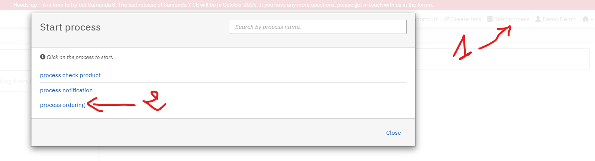
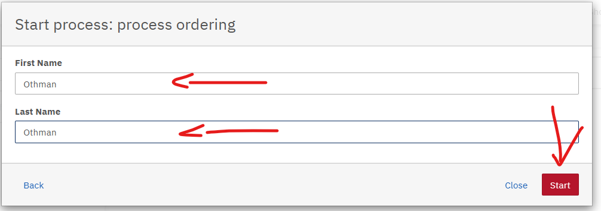
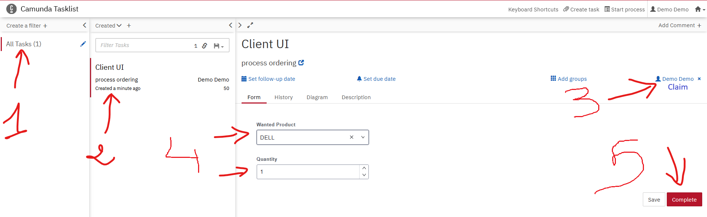

### Simple project BPMN camunda version 7

### Swagger UI
http://localhost:9099/app/swagger-ui/index.html

### host
http://localhost:9099

### h2 DB
http://localhost:9099/h2-console

### camunda dashboard
http://localhost:9099/camunda/app/welcome/default/#!/welcome

### Errors

ERROR EVENT END : will throw the exception
ERROR EVENT BOUNDARY : will catch the exception

### End point Rest
http://localhost:9099/engine-rest

### Test scenario
1 - start [taskList](http://localhost:9099/camunda/app/tasklist/default/)  
2 - start process ``process ordering``

3 - observe logs in back end